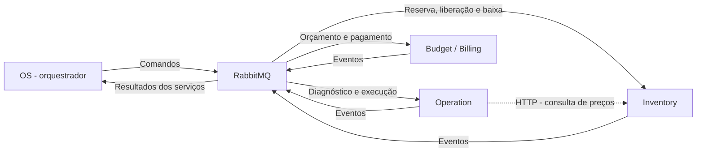
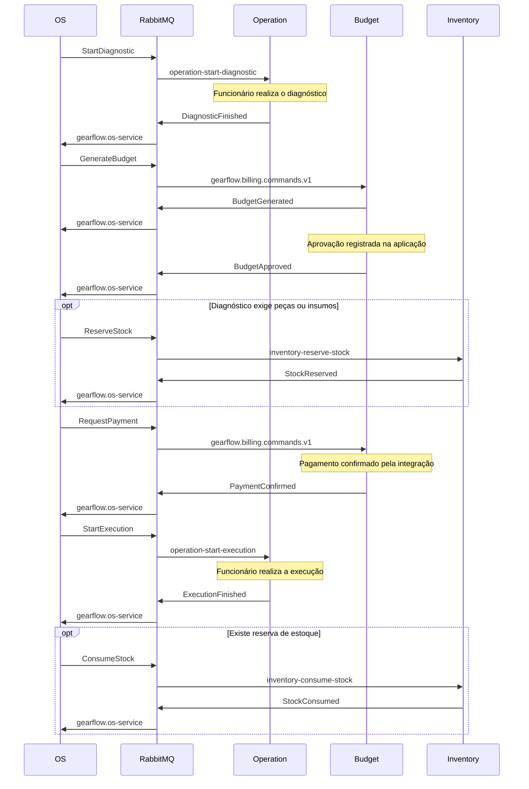

# GearFlow — comunicação entre microsserviços e conexão ao RabbitMQ

**Referência:** código dos serviços consultado em 08/11/2026 e topologia atual do `gearflow-infra-broker`.

**Público:** integrantes responsáveis por OS, Budget, Operation e Inventory.

Este guia explica a integração existente e como configurar cada serviço para o broker compartilhado. A infraestrutura foi adaptada e testada localmente; o deploy dessa configuração no EKS e o teste conjunto das aplicações ainda estão pendentes. As pendências de negócio estão identificadas na seção 9.

## 1. Quem faz o quê

| Componente | Responsabilidade na integração |
|---|---|
| **OS** | Coordena a Saga: recebe resultados e decide qual comando enviar em seguida. Mantém o acompanhamento da ordem de serviço. |
| **Budget / Billing** | Gera orçamento, registra aprovação/rejeição e conduz a integração de pagamento. Budget é o nome do repositório; Billing aparece no código e nos nomes do RabbitMQ. |
| **Operation** | Recebe pedidos de diagnóstico e execução; publica o andamento e o resultado dessas atividades. |
| **Inventory** | Reserva, libera e baixa estoque; publica insuficiência, reposição e alertas. |
| **RabbitMQ** | Recebe, encaminha e armazena mensagens até seu consumo. Não decide regras da Saga nem transforma os formatos JSON. |

**Comando** pede uma ação: `ReserveStock` significa “reserve este estoque”. **Evento** informa um fato: `StockReserved` significa “o estoque foi reservado”.

**Exchange** recebe publicações; **binding** define o encaminhamento; **fila** guarda as mensagens; **consumidor** é o código que as processa. A **routing key** é o nome usado no encaminhamento quando o tipo de exchange a considera.

## 2. Visão geral da comunicação



As setas de comandos/eventos representam publicações e consumo de filas no RabbitMQ. Os serviços não chamam diretamente os handlers uns dos outros.

Há também comunicação síncrona: o Operation possui um cliente HTTP para consultar preços no Inventory. Essa consulta tem configuração e credencial próprias e não passa pelo RabbitMQ. A integração do Budget com o Mercado Pago também ocorre por HTTP/webhook.

Cada serviço utiliza seu próprio banco. Mensagens não autorizam acesso ao banco de outro serviço.

## 3. Fluxo principal de uma OS

O diagrama abaixo resume o caminho implementado. Diagnóstico, aprovação, pagamento e execução dependem das ações HTTP/webhook previstas nas aplicações; não avançam todos automaticamente ao abrir uma OS.



O evento de abertura `OrderCreated`, publicado com as rotas `os.created` e `os.order-created.v1`, continua existindo. **Ele não é o comando que gera orçamento no Budget atual:** a OS envia `GenerateBudget` depois de receber `DiagnosticFinished`.

### Caminhos alternativos encontrados

| Ocorrência | Comportamento observado na OS |
|---|---|
| Estoque insuficiente | Recebe `StockInsufficient` e registra espera por peças. |
| Reposição de estoque | Recebe `StockReplenished` e tenta novamente a reserva das OS que aguardam peças. Esse evento é global e não pertence a uma única OS. |
| Falha de pagamento | Recebe `PaymentFailed`; se houver reserva, envia `ReleaseStock`. |
| Orçamento rejeitado ou diagnóstico falhou | Envia `CancelOperation`; libera estoque se houver reserva e envia `CancelBudget` se houver orçamento identificado. |
| Estorno | Budget aceita `RefundPayment`, mas a saga atual não despacha esse comando automaticamente. |

Esses comportamentos descrevem o código atual. Não representam a conclusão de todas as regras de cancelamento e compensação do projeto.

## 4. Onde cada mensagem é entregue

### Comandos para o Budget

Exchange **topic** `gearflow.commands.v1`; fila **quorum** `gearflow.billing.commands.v1`.

| Comando | Routing key | Payload principal |
|---|---|---|
| GenerateBudget | `billing.GenerateBudget` | customer, items, expiresOn |
| RequestPayment | `billing.RequestPayment` | budgetId, amount, currency |
| CancelBudget | `billing.CancelBudget` | budgetId, reason |
| RefundPayment | `billing.RefundPayment` | budgetId, paymentId, reason |

### Comandos para Operation e Inventory

A OS atual publica na exchange padrão, cujo nome AMQP é a string vazia `""`. A routing key é exatamente o nome da fila. O corpo usa o envelope MassTransit.

| Destino | Comando | Fila / routing key | Enviado pela OS atual? |
|---|---|---|---|
| Operation | StartDiagnostic | `operation-start-diagnostic` | Sim |
| Operation | StartExecution | `operation-start-execution` | Sim |
| Operation | CancelOperation | `operation-cancel-operation` | Sim |
| Operation | UpdateOperationVehicle | `operation-update-vehicle` | Não encontrado |
| Operation | DeactivateOperation | `operation-deactivate` | Não encontrado |
| Inventory | ReserveStock | `inventory-reserve-stock` | Sim |
| Inventory | ReleaseStock | `inventory-release-stock` | Sim |
| Inventory | ConsumeStock | `inventory-consume-stock` | Sim |

O broker também prepara a topologia padrão de recepção do MassTransit: exchange do tipo da mensagem → exchange com o nome do endpoint → fila do endpoint. Isso permite a inicialização normal dos consumidores existentes. As filas acima são classic.

### Eventos de retorno para a OS

A OS consome uma única fila: **`gearflow.os-service`**. Os bindings dessa fila recebem os eventos abaixo.

| Origem | Exchange | Seleção / tipos assinados |
|---|---|---|
| Budget | `gearflow.events.v1` — topic | Binding `gearflow-budget-service.*`; nove tipos de evento listados abaixo |
| Operation | Uma exchange fanout por evento | `operation.diagnostic-finished`, `operation.diagnostic-failed`, `operation.execution-finished`, `operation.canceled`, `operation.command-rejected` |
| Inventory | Uma exchange fanout por evento | `inventory.stock-reserved`, `inventory.stock-insufficient`, `inventory.stock-released`, `inventory.stock-consumed`, `inventory.stock-replenished` |

Budget publica: `BudgetGenerated`, `BudgetGenerationFailed`, `BudgetApproved`, `BudgetRejected`, `BudgetCanceled`, `PaymentRequested`, `PaymentConfirmed`, `PaymentFailed` e `PaymentRefunded`. Em todos, a routing key e o `messageType` do envelope são `gearflow-budget-service.<Evento>`, preservando maiúsculas/minúsculas.

**Receber na fila não significa possuir tratamento de negócio.** A seção 9 identifica os eventos que a OS ainda ignora ou não trata especificamente.

Operation publica também eventos de acompanhamento em `operation.diagnostic-queued`, `operation.diagnostic-started`, `operation.execution-authorized`, `operation.execution-started`, `operation.job-executed`, `operation.vehicle-updated`, `operation.deactivated` e `operation.cancellation-rejected`. A OS atual não assina essas exchanges.

### Notificações e erros

| Recurso | Uso |
|---|---|
| `inventory-low-stock-alert-email` | Inventory consome seu evento `LowStockAlert`, vindo de `inventory.low-stock-alert`. |
| `inventory-stock-insufficient-email` | Inventory consome seu evento `StockInsufficient`, vindo de `inventory.stock-insufficient`. A OS recebe uma cópia independente. |
| `gearflow.billing.commands.v1.dlq` | Budget publica falhas explicitamente em `gearflow.deadletters.v1`, routing key `gearflow.billing.commands.v1`. Seu replay operacional pode consumir essa fila. |
| `<endpoint>_error` / `<endpoint>_skipped` | Destinos criados pelo MassTransit quando ocorrem falhas de consumo ou chegam mensagens sem consumidor compatível. |
| `gearflow.os.billing.events.v1` | Assinatura declarada pelo Budget com `gearflow-budget-service.*`. Não foi encontrado consumidor ativo; pode acumular cópias. Não substitui `gearflow.os-service`. |

Não há uma DLX global para todos os serviços. Cada aplicação conserva a estratégia de erro que já implementa.

## 5. Formatos de mensagem

### Budget: JSON próprio

Content-Type: **`application/json`**. Exemplo de `GenerateBudget`:

```json
{
  "messageId": "11111111-1111-4111-8111-111111111111",
  "messageType": "GenerateBudget",
  "schemaVersion": 1,
  "occurredOn": "2026-11-08T12:00:00Z",
  "correlationId": "22222222-2222-4222-8222-222222222222",
  "serviceOrderId": "22222222-2222-4222-8222-222222222222",
  "causationId": null,
  "producer": "gearflow-os-service",
  "payload": {
    "customer": {"name": "Cliente de demonstração", "email": "demo@example.invalid"},
    "items": [{
      "referenceId": "33333333-3333-4333-8333-333333333333",
      "type": "Job",
      "description": "Serviço de demonstração",
      "unitPrice": 100.00,
      "quantity": 1
    }],
    "expiresOn": "2026-11-11T12:00:00Z"
  }
}
```

Na publicação, usar exchange `gearflow.commands.v1` e routing key `billing.GenerateBudget`. As propriedades AMQP `MessageId` e `CorrelationId` precisam coincidir com os identificadores do envelope. O parser do Budget também verifica versão, produtor, tipo, data UTC e routing key.

Valores monetários são decimais; tipos de item: `Job`, `Part`, `Consumable`. Nos eventos, `producer` é `gearflow-budget-service` e `messageType` inclui esse prefixo.

### Operation e Inventory: envelope MassTransit

Content-Type: **`application/vnd.masstransit+json`**. Exemplo de comando enviado pela OS à fila `inventory-reserve-stock`:

```json
{
  "messageId": "11111111-1111-4111-8111-111111111111",
  "conversationId": "22222222-2222-4222-8222-222222222222",
  "correlationId": "22222222-2222-4222-8222-222222222222",
  "sourceAddress": "queue:gearflow-os-service",
  "destinationAddress": "queue:inventory-reserve-stock",
  "messageType": ["urn:message:GearFlow.Contracts:ReserveStock"],
  "message": {
    "correlationId": "22222222-2222-4222-8222-222222222222",
    "messageId": "11111111-1111-4111-8111-111111111111",
    "occurredOn": "2026-11-08T12:00:00Z",
    "items": [{
      "itemType": "Part",
      "itemId": "33333333-3333-4333-8333-333333333333",
      "quantity": 1
    }]
  }
}
```

Usar exchange `""`, routing key `inventory-reserve-stock`, propriedades AMQP MessageId/CorrelationId correspondentes e mensagem persistente. Esse é o caminho usado pelo código atual da OS.

Para Operation, a URN usa o namespace versionado: por exemplo, `urn:message:GearFlow.Contracts.Operation.V1:StartDiagnostic`. Mudar apenas o nome da exchange não substitui essa identidade do tipo.

Operation e Inventory já utilizam MassTransit 8.5.11: seus produtores devem continuar usando os DTOs e a configuração de nomes existentes, deixando a biblioteca montar o envelope. A OS já possui seu adaptador para esses envelopes; não precisa adotar MassTransit para se conectar.

No snapshot comercial do Operation, preços são inteiros em centavos; na integração com Budget, são decimais. A OS já faz a conversão `/ 100m` e traduz `Labor` para `Job`. Inventory usa `Part`/`Consumable` como strings; quantidade é decimal, com peças inteiras e insumos possivelmente fracionários.

Para mensagens relacionadas a uma OS, `CorrelationId` identifica a OS. `MessageId` identifica a mensagem e deve ser preservado ao reenviar a mesma entrega. `StockReplenished` e `LowStockAlert` são globais e não possuem CorrelationId de OS.

## 6. Como conectar no RabbitMQ compartilhado

### Parâmetros comuns no Kubernetes

| Parâmetro | Valor |
|---|---|
| Protocolo | AMQP 0-9-1, sem TLS |
| Host | `rabbitmq.messaging.svc.cluster.local` |
| Porta | `5672` |
| Virtual host | `gearflow` — não usar `/` |
| TLS / SSL | Desabilitado; nenhum certificado ou CA necessário |
| Autenticação | Usuário e senha próprios de cada serviço |

Cada serviço abre sua própria conexão com o RabbitMQ. **Dentro do cluster, não é necessário port-forward.** Os Pods acessam o Service Kubernetes pelo DNS acima. O painel `15672` é administrativo e não é a porta de mensagens.

### Usuários e entrega de credenciais

| Serviço | Usuário RabbitMQ | Secret de origem em `messaging` |
|---|---|---|
| OS | `gearflow_os` | `rabbitmq-os-credentials` |
| Budget | `gearflow_budget` | `rabbitmq-budget-credentials` |
| Operation | `gearflow_operation` | `rabbitmq-operation-credentials` |
| Inventory | `gearflow_inventory` | `rabbitmq-inventory-credentials` |

Cada Secret contém as chaves `username` e `password`. O bootstrap cria credenciais ausentes e preserva as existentes. **Não existe senha fixa no repositório ou neste documento.** O responsável pela infraestrutura entrega a cada serviço somente sua credencial.

Um Pod só referencia Secrets do próprio namespace. Se as aplicações estiverem em `gearflow` e o broker em `messaging`, o operador deve disponibilizar a credencial individual no namespace da aplicação. Pode manter o nome da tabela ou adaptar o Secret já utilizado pelo serviço, preservando as chaves de configuração esperadas. Não copiar a conta administrativa nem todas as senhas para cada serviço.

### Exemplo de configuração no Deployment

Fragmento para o **Inventory**, supondo que seu Secret individual já tenha sido disponibilizado no namespace da aplicação:

```yaml
spec:
  template:
    metadata:
      labels:
        gearflow.io/rabbitmq-client: "true"
    spec:
      containers:
        - name: api
          env:
            - name: RabbitMq__Host
              value: rabbitmq.messaging.svc.cluster.local
            - name: RabbitMq__Port
              value: "5672"
            - name: RabbitMq__VirtualHost
              value: gearflow
            - name: RabbitMq__Tls
              value: "false"
            - name: RabbitMq__Username
              valueFrom:
                secretKeyRef:
                  name: rabbitmq-inventory-credentials
                  key: username
            - name: RabbitMq__Password
              valueFrom:
                secretKeyRef:
                  name: rabbitmq-inventory-credentials
                  key: password
```

É um fragmento para incorporar ao Deployment existente, preservando imagem, recursos e demais configurações. Nos outros serviços, trocar o Secret pelo correspondente. OS e Operation não possuem opção TLS nos pontos de conexão consultados; usam AMQP sem habilitação de SSL. No .NET, `__` representa a hierarquia: `RabbitMq__Host` corresponde a `RabbitMq:Host`.

### Autorizar a origem na rede

O namespace da aplicação precisa da label de acesso. Exemplo, se o namespace utilizado pelo grupo for `gearflow`:

```powershell
kubectl label namespace gearflow gearflow.io/messaging-access=true --overwrite
```

A label `gearflow.io/rabbitmq-client: "true"` deve estar no **template de Pods** de cada Deployment, como no exemplo anterior. As duas labels são necessárias simultaneamente. Se o serviço restringir seu egress, permitir DNS e TCP 5672 para o broker também.

### Configurações específicas por serviço

| Serviço | Configuração / ajuste necessário |
|---|---|
| OS | Definir o host completo acima; manter `RabbitMq__Exchange=gearflow.events`, `RabbitMq__CommandsExchange=gearflow.commands.v1`, `RabbitMq__BillingEventsExchange=gearflow.events.v1`, `RabbitMq__Queue=gearflow.os-service`. O manifesto consultado ainda usa host curto `rabbitmq`, que em outro namespace aponta para o destino errado. |
| Budget | `RabbitMq__Enabled=true`, `RabbitMq__Tls=false`, `RabbitMq__QueueType=quorum`, host/porta/vhost comuns. Manter nomes de exchanges/filas do catálogo. Ajustar a validação em `PaymentIntegrationRegistration.cs`, que hoje exige TLS fora de Development. Só definir `Tls=false` ainda impede o startup no ambiente Production atual. Não mudar o ambiente inteiro para Development como contorno. |
| Operation | `Messaging__Enabled=true` para iniciar consumidores e `Messaging__DispatchEnabled=true` para publicar o Outbox; preencher host/porta/vhost/usuário/senha. O manifesto consultado deixa essas duas opções como false. |
| Inventory | `RabbitMq__Tls=false`, porta 5672, host/vhost comuns. Remover a configuração de CA e o volume/mount obrigatório `rabbitmq-ca` do Deployment. Manter os nomes de eventos e endpoints já configurados no MassTransit. |

O Budget deve usar quorum ao conectar a um broker preparado pelas definições atuais do infra-broker, inclusive no Compose deste repositório, porque suas três filas seguem o manifesto Kubernetes do serviço. O padrão local de seu código é classic; uma declaração com tipo diferente falha. A infraestrutura continua com um único RabbitMQ, sem alta disponibilidade.

### Desenvolvimento fora do cluster

Para um broker próprio do Compose local: host `localhost`, porta `5672`, vhost `gearflow` e credenciais desse ambiente. Containers precisam usar o DNS da rede Docker apropriada; `localhost` dentro de um container aponta para ele próprio.

Se for necessário executar um serviço na máquina e acessar o **broker do EKS**, um operador com acesso Kubernetes pode manter este túnel aberto:

```powershell
kubectl -n messaging port-forward service/rabbitmq 5673:5672 --address 127.0.0.1
```

Nesse caso, o serviço local usa host `127.0.0.1`, porta `5673`, vhost `gearflow`, TLS desabilitado e sua credencial do EKS. O túnel dura enquanto o comando estiver ativo. Ele não é usado na comunicação normal dos Pods e não valida o bloqueio de rede por labels.

## 7. Permissões e responsabilidade pela topologia

A infraestrutura prepara a topologia de base e administra usuários/permissões. **As aplicações podem repetir suas declarações e o MassTransit pode criar seus recursos auxiliares**, conforme o código existente. Os usuários não possuem acesso administrativo ao painel.

| Usuário | Acesso funcional |
|---|---|
| OS | Publica abertura, comandos Billing e comandos pela exchange default; consome sua fila de resultados. Declara seus recursos, exchanges de eventos e seis filas usadas no envio a seus pares. |
| Budget | Declara recursos Billing; consome comandos; publica eventos/falhas. Também pode consumir sua DLQ e republicar comandos, como exige o replay operacional implementado. |
| Operation | Declara e utiliza recursos `operation-*`, `operation.*`, tipos e auxiliares do MassTransit correspondentes. |
| Inventory | Declara e utiliza recursos `inventory-*`, `inventory.*`, tipos e auxiliares do MassTransit, incluindo as filas de email. |

O consumo das filas de comando de outro serviço é negado. As permissões também precisam cobrir bindings: elas não se resumem a “publicar na exchange” e “ler a fila”.

Existem limites da ACL padrão que preservamos para funcionar com o código: `configure` permite criação e exclusão dentro do escopo; a OS autorizada na exchange default pode publicar em qualquer fila existente do vhost; os nomes temporários de bus do MassTransit seguem um padrão comum a Operation/Inventory. Esses acessos não tornam os usuários administradores. Detalhes e padrões exatos: [mensageria e ACL](messaging.md#permissoes-por-aplicacao).

## 8. Como verificar e diagnosticar

O operador deve aplicar a versão atual do infra-broker pelo CD ou pelo bootstrap antes do teste conjunto. Os responsáveis pelas aplicações devem conferir suas configurações da seção 6 e iniciar os serviços com seus próprios usuários.

Durante uma demonstração controlada, acompanhar a publicação do comando, o consumidor na fila de destino, o evento resultante e sua chegada à OS. Algumas mensagens desaparecem rapidamente das filas porque já foram consumidas; fila vazia não prova falha.

| Sintoma | Conferir primeiro |
|---|---|
| Nome do broker não resolve | Host completo e DNS do cluster; fora do cluster usar o túnel ou broker local. |
| Timeout na conexão | Labels do namespace e do Pod, egress, Service e porta 5672. |
| Falha de TLS/handshake | Cliente ainda configurado com TLS ou porta 5671. |
| Login recusado | Usuário/senha da instalação atual e virtual host `gearflow`. |
| `ACCESS_REFUSED` em operação | ACL aplicada pelo CD, usuário correto e nome exato do recurso. |
| `PRECONDITION_FAILED` na declaração | Tipo da exchange, tipo da fila (quorum/classic), durabilidade e argumentos divergentes. Não apagar filas com dados para contornar. |
| Comando fica na fila | Consumidor parado, endpoint diferente, erro de startup; no Operation conferir as duas flags de mensageria. |
| Mensagem em `_skipped` | URN/tipo, Content-Type, envelope ou consumidor incompatível. |
| Mensagem em `_error` ou DLQ | Erro de desserialização/handler e política de falha da aplicação; diagnosticar antes de reenviar. |
| Evento chega à OS, mas não altera o estado | Handler ausente, estado de negócio incompatível ou evento meramente informativo; ver seção 9. |

Testes disponíveis no infra-broker: `Test-SharedBroker.ps1` valida transporte/ACL com clientes AMQP e MassTransit em Docker descartável; `Test-Broker.ps1 -RestartBroker` valida persistência e rotas em vhost isolado; `Test-ClusterBroker.ps1` prepara usuários/vhost de teste e verifica AMQP/rede no EKS. O parâmetro de restart interrompe conexões e exige janela sem consumidores. Não publicar mensagens fictícias nas filas de negócio com consumidores reais ativos.

## 9. Pendências conhecidas das aplicações

| Pendência | Efeito atual / responsável |
|---|---|
| OperationCommandRejected | OS assina, mas o parser não reconhece. A recusa de um comando pode passar sem reação da Saga. |
| OperationCancellationRejected | OS não assina; recusa do cancelamento não chega à Saga. |
| BudgetGenerationFailed | OS reconhece, mas não possui ação específica. Pode continuar esperando orçamento. |
| PaymentRefunded, StockReleased, OperationCanceled | OS reconhece, mas não possui ação específica para essas confirmações. Definir se serão informativas ou parte da conclusão de compensações. |
| BudgetCanceled, PaymentRequested | Entregues à fila OS pelo binding do Budget, mas o parser não reconhece. |
| Orçamento revisado e linhas aprovadas | OS usa revisão 1 e deriva IDs das linhas do diagnóstico. Os responsáveis devem validar esse vínculo com Budget/Operation. |
| Pedido inicial de diagnóstico | OS envia requestedJobs/requestedParts vazios. Confirmar como o pedido chega ao funcionário. |
| Assinatura extra do Budget | Decidir o destino de `gearflow.os.billing.events.v1`, hoje sem consumidor identificado. |

A OS confirma mensagens desconhecidas/ilegíveis e resultados reconhecidos sem ação específica conforme seu código atual; eles não ficam esperando um handler futuro no RabbitMQ. Essas decisões precisam ser tratadas pelos responsáveis pelas aplicações.

## 10. Referências do projeto

- [Catálogo de nomes e versões consultadas](../rabbitmq/contracts.json).
- [Exchanges, filas e bindings aplicados](../rabbitmq/definitions.json).
- [Permissões por usuário](../rabbitmq/service-permissions.json).
- [Operação e rede no Kubernetes](../k8s/README.md).
- [Documentação técnica da adaptação](messaging.md).
- [Limites do teste com contratos MassTransit](../tests/TransportProbe/README.md).

As estruturas completas dos DTOs estão nos repositórios dos serviços. Alterações coordenadas nesses contratos devem atualizar o catálogo, as definições geradas, as cópias usadas no teste e este guia. Não incluir senhas nessas atualizações.
